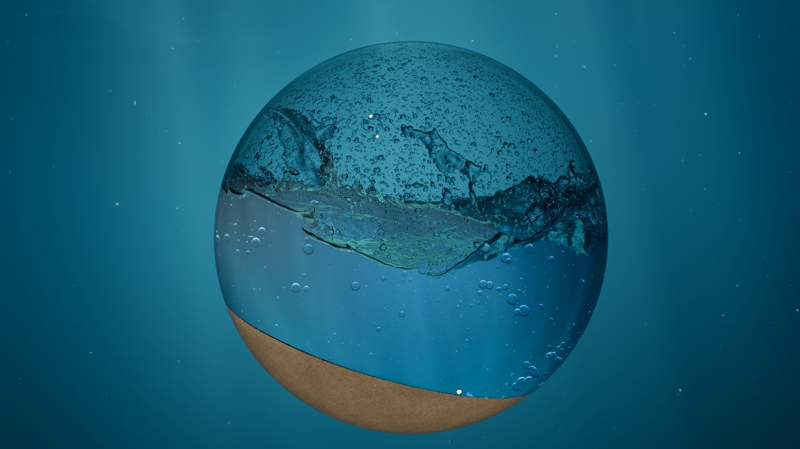
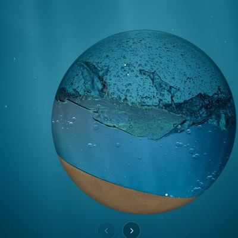
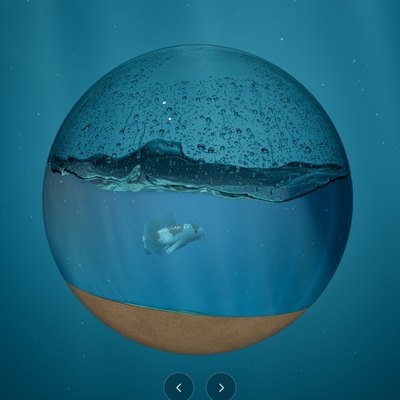
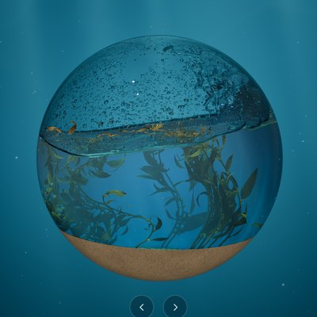
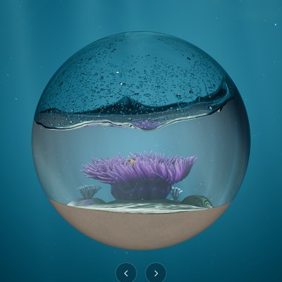
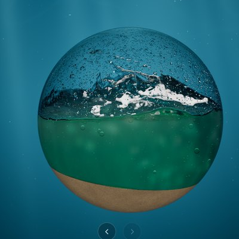

# Globes

Glass globes of water, simulated live on the GPU.



Tilt a globe and the water sloshes, settles, and throws caustics across the sand. Shake it and
the water splashes against the glass, churns full of bubbles, and leaves drops on the glass
above the water line that merge and run down in trails. Everything is simulated in real time
with WebGPU and drawn with [three.js](https://threejs.org).

**[Try it in your browser](https://globes-nine.vercel.app)** (it needs WebGPU and a fast GPU).

| Clear Water | Koi | Kelp Forest | Anemone Reef | Sea Foam |
| :-: | :-: | :-: | :-: | :-: |
|  |  |  |  |  |

## What's inside

- **Water:** FLIP/APIC fluid on a 128³ grid, about four million particles, all in compute
  shaders.
- **Sand:** a bed that flows like a granular material when the globe tilts.
- **Light:** the water is ray marched and refracted through thin glass, with caustics on the
  sand, light shafts and drifting motes.
- **Splash:** bubbles, spray, and drops that cling to the glass, merge, run and leave trails.
- **Sea foam:** foam with real thickness, light scattering through it, and bubbles up close.
- **Life:** a koi, a kelp forest, and an anemone reef with two clownfish. Right-click to drop
  in fish food.
- **Hardware ray tracing**, optional: in a browser built with
  [these patches](https://github.com/willwaltz/webgpu-ray-tracing), the water march uses ray
  queries to skip empty space.
- **Desktop globes:** the Electron app can put a globe on your desktop, bending your wallpaper
  through its glass.

## Requirements

- **A fast GPU.** Globes was developed on an NVIDIA RTX 4090, where it runs at about 80–120
  fps depending on the globe. Phones and tablets get a lighter version automatically.
- **WebGPU.** Developed in Chromium-based browsers and Electron; other browsers are untested.
  On Linux, the Electron app is the easiest way in, since it sets up WebGPU itself.
- **Node.js 22.12 or newer**, to build and run it.

Developed and tested on Linux (GNOME on Wayland). Desktop globes read GNOME's wallpaper
settings.

## Running it

```sh
npm install
npm run dev     # the Electron app (Vite runs inside it, with hot reload)
npm run web     # a Vite dev server: open the address it prints in a WebGPU browser
npm run build   # typecheck, then build the static site into dist/
npm start       # build, then run the Electron app from dist/
```

## Controls

| | |
| --- | --- |
| Drag the globe | Tilt it; let go and it rocks back upright |
| Ctrl + drag | Spin it about its axis, or lean it towards or away from you |
| Scroll or pinch | Zoom |
| ← → or the arrows under the globe | Switch globes |
| Right-click (Koi, Anemone Reef) | Drop in fish food |
| Move the pointer | Stir the water around the globe |

## URL options

For development and tuning:

- `?globe=water|koi|kelp|reef|foam`: start on a globe
- `?stats`: log the frame rate and the simulation's substeps to the console
- `?rt=0`: trace in software even where hardware ray tracing is available
- `?aa=1`: one ray per pixel instead of four
- `?res=96`: a coarser simulation grid (the default is 128); more of the solver's settings are
  in [`src/config.ts`](src/config.ts)
- `?splash=0`: no bubbles, spray or drops on the glass

## Hardware ray tracing

No browser ships ray tracing in WebGPU yet, so Globes can use a non-standard version:
[webgpu-ray-tracing](https://github.com/willwaltz/webgpu-ray-tracing) patches Chromium (its
WebGPU implementation, Dawn, and its shader compiler, Tint) to add acceleration structures and
ray queries in WGSL.

Where the browser offers that feature (`chromium-experimental-ray-query`), Globes outlines the
parts of the globe that hold water in triangles every frame. Ray queries then let the water
march skip the empty space in between. The picture is the same as tracing in software, about
10–30% faster. In a hard shake all those outlines make the hardware slower, so Globes traces in
software until the water calms. `?rt=0` turns it off.

## How it works

[`docs/architecture.md`](docs/architecture.md) is the design log: the solver, the sand,
caustics, rendering, hardware ray tracing, each globe, the app, and the performance lessons
learned along the way.

Built with [three.js](https://threejs.org) (its WebGPU renderer), [Vite](https://vite.dev),
[Electron](https://www.electronjs.org) and the [Inter](https://rsms.me/inter/) typeface.

## License

[MIT](LICENSE)
